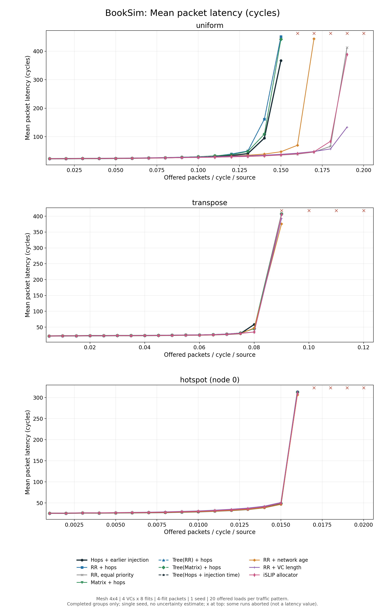

BookSim Interconnection Network Simulator
=========================================

BookSim is a cycle-accurate interconnection network simulator.
Originally developed for and introduced with the [Principles and Practices of Interconnection Networks](http://cva.stanford.edu/books/ppin/) book, its functionality has since been continuously extended.
The current major release, BookSim 2.0, supports a wide range of topologies such as mesh, torus and flattened butterfly networks, provides diverse routing algorithms and includes numerous options for customizing the network's router microarchitecture.

## Сборка и запуск

Нужны C++ компилятор, Make, Flex и Bison. Команды из корня проекта:

```sh
make -C src -j4
./src/booksim configs/hop_age_mesh.cfg
```

## Что добавлено

Арбитр `hop_age` для распределения коммутатора. Сначала выбирает флит с большим
числом переходов (`hops`), при равенстве — с меньшим `itime`, затем — по кругу.
`itime` — номер такта входа флита в сеть: меньшее значение означает более ранний вход.

Число переходов берётся из встроенного режима `priority = hop_count`.
Время входа передаётся отдельным полем через заявки в новый арбитр.
Пример настроек — [configs/hop_age_mesh.cfg](configs/hop_age_mesh.cfg).
Поддерживается switch allocation без спекуляции, удержания соединения
и заимствования приоритета.

Для проверок нужен Python 3, для графиков — также `matplotlib`:

```sh
python3 scripts/test_hop_age.py   # Проверки сетевых запусков и настроек
python3 scripts/compare_arbiters.py # Сравнение алгоритмов
```


## Сравнение

10 конфигураций: `round_robin`, `matrix`, `tree`, `hop_age` и базовые политики.
Mesh 4×4, четыре VC по восемь флитов, пакет — четыре флита. 20 уровней нагрузки, один seed=1.
На прогон: 6000 тактов прогрева и 9000 измерения. Меньшая задержка лучше.
Прерванные точки отмечены крестиками сверху; это не значения задержки.
Разброс по seed не оценивался. Порог остановки — 500 тактов средней задержки.



[Пропускная способность](docs/comparison/throughput.png) · [p99 задержки](docs/comparison/p99.png)

---

If you use BookSim in your research, we would appreciate the following citation in any publications to which it has contributed:

Nan Jiang, Daniel U. Becker, George Michelogiannakis, James Balfour, Brian Towles, John Kim and William J. Dally. A Detailed and Flexible Cycle-Accurate Network-on-Chip Simulator. In *Proceedings of the 2013 IEEE International Symposium on Performance Analysis of Systems and Software*, 2013.
